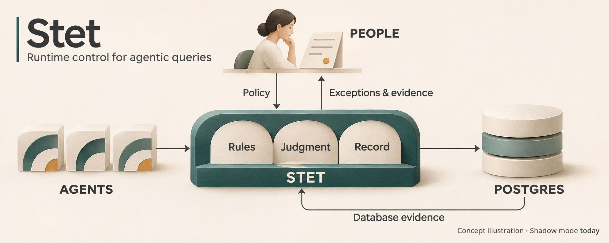

# Stet

**Runtime control for agentic queries. Stet asks the database instead of guessing from the SQL.**

> *Agents propose. Stet decides what stands.*

AI agents now write SQL at run time and send it with nobody reading it first. Stet is a Postgres wire-protocol proxy that stands on the one path those agents use to reach your database. Before an agent's write goes through, Stet asks the database what the write would actually do, decides whether it should commit, hold, escalate or be rejected, and records why.

The point is delegation. The more work a company hands to agents, the less of it a person checks. Stet puts that check back at the moment of execution and keeps people in charge of the policy, not of every query.

Integration is a connection string. Agents connect to Stet as if it were Postgres. Your services keep connecting to Postgres directly, so Stet adds nothing to their latency and cannot take them down.

> **Status (2026-11-16): early, shadow mode only.** Stet observes, judges and records. It does not block anything yet. Details in [Status](#status).

## The problem: nobody reads an agentic query

Databases were built for clients that are deterministic code: written by a person, reviewed, tested, deployed. An agentic query is none of those. A model writes it at run time, from whatever the agent read a few seconds or a few hours ago, and it runs under credentials that are usually wider than the task.

Three things go wrong.

| Risk | What happens |
|---|---|
| Leak | The agent reads what it should not |
| Destruction | The agent deletes or breaks data |
| Corruption | The agent has permission, the SQL is valid, and the data ends up wrong |

Most guardrails for agents judge the statement text. The text does not say much:

```sql
DELETE FROM contacts WHERE last_seen < $1;
```

Is that three rows or three million? Does it cascade into `deals`? Did another agent change these rows after this one read them? The statement cannot tell you. The database can.

## What Stet does

Stet asks the database first and a model last.

| Tier | The question Stet asks | Needs a model | Today |
|---|---|---|---|
| 1. Measure the impact | How many rows, what share of the table, how far through foreign keys? | No | Spec drafted |
| 2. Make it reversible | Can this exact write be undone? Small writes go through and stay reversible instead of being blocked | No | Before-values recorded for single-row writes |
| 3. Judge the values | Is this a duplicate? Does it undo a recent change? Does it break a written policy? | Yes, a small judgment model | Working, in shadow mode |
| 4. Catch stale writes | Has the row changed since this session read it? | No | Row versions recorded |

- **Deterministic checks run first.** A write that a rule can settle never reaches a model. That keeps cost and latency low, and it keeps the model out of the security boundary.
- **Every verdict has a reason an agent can act on.** `duplicate:4812` names the row it collides with. `policy:2` names the rule it breaks.
- **Every decision is recorded.** `stet.decisions` is an append-only log of who wrote, on whose behalf, what the database looked like, which pinned model version judged it, and what was decided. Replays read the recorded judgment and never ask the model again.

### People stay in charge

Human in the loop does not have to mean an approve button on every query. That design does not survive volume, and people who are asked too often stop reading what they approve.

| Who | Responsibility |
|---|---|
| Deterministic controls | Enforce the limits nothing may cross: permissions, impact limits, forbidden statement shapes |
| Judgment model | Judge what needs meaning, and say so when it is not sure |
| People | Set what is delegated and under which policy, review exceptions and outcomes, adjust the policy, stop or undo |

- In normal operation Stet acts inside the policy and limits people set.
- A write goes to a person when it is uncertain, large, or hard to undo. Stet weighs all three, and all three come from the database.
- The person sees the same evidence Stet used: "48,211 rows, 24% of the table, cascades into `deals`", not "risk: high".

The decision log and the label columns for human review exist today. Approving and rejecting held writes is on the roadmap, straight after enforce mode.

## Where it sits

```
 services (high volume) ──────────────────> Postgres
 agents ───────────────> stet ────────────> Postgres
                           │
                           └──> judgment model, before the write
```

- **Agents only.** High-volume service traffic never passes through Stet. An agent step takes seconds, so a judgment that takes a quarter of a second fits.
- **On the database side.** A control that lives on the agent's machine can be skipped by the agent. A control next to the database sees every agent at once, which is the only place conflicts between agents are visible.
- **Identity comes from the database role, not from what the agent says about itself.** Agent roles are set up so they only work through Stet. This arrives with enforce mode. Today Stet selects what to judge by table.
- **Which paths go through Stet is the company's rule to set.** That includes services that run queries on an agent's behalf, such as an MCP server: they connect with an agent role, through Stet. The statement shape is then written by a person and only the values come from the agent, and value-level judgment and impact limits still apply.

## What we measured

We recorded 1,461 writes against a synthetic B2B CRM, then replayed the same recorded state through each gate. The scored set held 414 defective writes (near-duplicate contacts, stale titles, status changes that contradict an open deal, consent with no source) and 851 legitimate ones.

| Gate | Defects caught | Legitimate writes held | p95 latency | Cost per 1,000 writes |
|---|---|---|---|---|
| Stet with a judgment model (TypeSafe Jev) | 97.6% | 1.1% | 249 ms | $0.048 |
| The same questions put to Claude Opus 5.5 | 99.5% | 0% | 5.4 s | $8.31 |

Database constraints plus fuzzy matching, with no judgment, caught 23.2% of the same defects.

Then we looked for where a model is actually needed. We wrote 400 legitimate writes that sit right next to a rule boundary, such as a new contact who shares a family name with an existing one, or a job title rewritten as its abbreviation. We ran them through the judgment model and through the same policies ported to code and tuned once.

| Gate | Legitimate near-boundary writes held |
|---|---|
| Policies as hand-tuned rule code | 31.2% |
| Stet with a judgment model | 2.5% |

Two results cut against us, and they shaped the design.

- A frontier agent (Claude Opus 5.5) avoided most traps on its own. It produced 14 defective writes across 326 planted traps.
- Plain rule code caught every policy violation we injected. It fell behind only on near-duplicates.

So Stet does not bet on agents being careless, and it does not put a model where a rule will do. It bets on two things that stay true as models improve: what even a perfect agent cannot know (what other agents wrote after it last read), and what must exist even when the write is right (who wrote what, for whom, having read which version).

Pass and fail criteria were fixed before we looked at results. The data is synthetic and most defects were injected by script. Latency was measured on one development machine at four concurrent requests. Method, raw numbers and limits are in [docs/lab.md](docs/lab.md).

## Status

| Capability | State |
|---|---|
| pgwire proxy, simple and extended query protocol | Working |
| Shadow mode: assemble state, judge, record, never change the write | Working |
| Value-level judgment on single-row writes (duplicate, conflict, policy) | Working, in shadow mode |
| Append-only decision log, replay and scoring lab | Working |
| Impact measurement for multi-row writes | Spec drafted |
| Enforce mode: block the write and return the reason | Next |
| Human review: approve or reject a held write, with a row-version re-check | Planned, after enforce |
| Reversal, stale-write detection | Planned |
| TLS, role-based identity, credential custody | Planned |
| Reads: recording, limits, masking | Planned |

What that means in practice today:

- Stet is safe to put in the path of an agent because it changes nothing. It is not yet a control, and it is not a security boundary.
- There is no TLS yet. Use it against a local Postgres or one in the same private network.
- Writes inside an explicit transaction are recorded but not judged.

## Roadmap

1. Impact measurement, in shadow mode.
2. Minimal enforce: block, return a structured reason, fail closed by default.
3. A minimal path for people: see a held write with its evidence, approve or reject it, re-check row versions on approval.
4. A head-to-head benchmark against statement-level guardrails, including an attack set, with criteria fixed in advance.
5. Reversal: before-values for every affected row, undo by session.
6. Stale-write detection.
7. TLS, role-based identity, credential custody, availability.
8. Breadth: a review UI and alerts, masking, a control plane, more protocols, then other data platforms.
9. Quality: a cache that knows when it is stale, and hints drawn from the session record.

The destination is one control layer for every agentic query, reads as well as writes, whoever sends it: an agent that made a mistake, an agent that was fed an injected instruction, or an agent run by an attacker. At the database they look the same, so Stet does not guess intent. It bounds what any session can do and keeps a record of what it did. The reasoning is in [docs/concept-v0.2.md](docs/concept-v0.2.md).

## Built to sit in front of a production database

- Model calls never run inside a Postgres transaction.
- Model versions are pinned. Aliases such as `latest` are rejected when the config is validated.
- The decision log is append-only. Only the after-the-fact label columns can be updated.
- Replay uses the recorded judgment. It never infers again.
- Data written by agents is untrusted input. Its origin is marked, deterministic constraints run before any judgment, and judgment never replaces them.
- Shadow mode never changes the original behaviour.
- You choose which columns a model may see. `send_fields` is mandatory, with no "all columns" default.
- Statements Stet does not gate may add at most 2 ms at p95. A test holds that budget.
- The model interface is neutral. TypeSafe Jev is the first adapter, and a Claude adapter exists for experiments.

## Quick start

Requirements: Go 1.27 or later. Integration tests also need Postgres binaries (`initdb`, `pg_ctl`, `psql`) on `PATH`.

```bash
go build -o bin/stet ./cmd/stet
cp stet.example.yaml stet.yaml        # set upstream, tables and send_fields
bin/stet proxy -config stet.yaml
```

Point the agent's connection string at Stet's `listen` address. Then read what Stet recorded:

```sql
select * from stet.decisions order by created_at desc;
```

- To judge with Jev, set `TYPESAFE_API_KEY` in the environment.
- To record writes and state with no model, set `model: {adapter: none}`.
- To measure Jev latency yourself, run `bin/stet bench-jev -n 60 -version jev-1.14.0`.

### Tests

Integration tests run against a throwaway Postgres. Without `STET_TEST_PG` they are skipped.

```bash
scripts/testdb.sh start /tmp/stet-pg    # port 55432, creates test accounts per auth method
export STET_TEST_PG=127.0.0.1:55432
go test -race ./...
scripts/testdb.sh stop /tmp/stet-pg
```

### Layout

| Package | Role |
|---|---|
| `cmd/stet` | CLI (`stet proxy`, `stet bench-jev`) |
| `internal/config` | Loads and validates `stet.yaml`. Rejects model version aliases |
| `internal/proxy` | pgwire proxy. Tracks statements, results and transaction state per session and reports them to the gate |
| `internal/sqlparse` | Classifies writes to gated tables (pass / gated / unsupported), reads `stet.on_behalf_of` |
| `internal/gate` | Assembles state, calls the judgment, records the decision |
| `internal/decide` | Model-neutral `Decider` interface, question set, verdict policy |
| `internal/decide/jev` | TypeSafe Jev adapter |
| `internal/decide/claude` | Claude adapter, used by the lab |
| `internal/store` | `stet.decisions` schema and writes |
| `cmd/stet-lab`, `internal/lab/*` | Experiment tooling: synthetic CRM, tasks, defect injection, labels, replay and scoring |

## Open core

| Open source (Apache 2.0) | Managed (paid) |
|---|---|
| pgwire proxy | Inference optimisation: caching, batching, version pinning, billing per judgment |
| Judgment write gate | Confidence calibration per customer |
| Decision log schema | A judgment model trained on decision and outcome data |
| Shadow mode | Audit dashboard, review UI for held writes, team permissions |
| Model adapter interface | Compliance reports |
| Invalidation and re-evaluation (planned) | |

Open-source users bring their own model API key. The license stays as first chosen.

## Documentation

The design documents are written in Korean for now.

- [docs/concept-v0.2.md](docs/concept-v0.2.md): the v0.2 concept and direction
- [docs/spec-v0.2-impact.md](docs/spec-v0.2-impact.md): draft spec for impact measurement
- [docs/spec-v0.1.md](docs/spec-v0.1.md): the v0.1 technical spec
- [docs/experiment.md](docs/experiment.md): experiment design and go / kill criteria
- [docs/lab.md](docs/lab.md): experiment runs and results
- [docs/decisions.md](docs/decisions.md): decision record and open questions
- [docs/landscape.md](docs/landscape.md): the surrounding landscape
